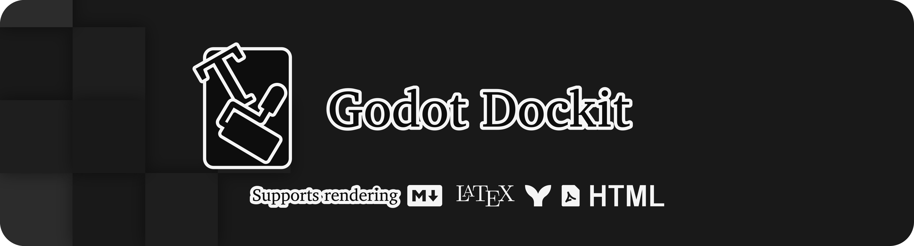

Render Markdown, LaTeX formulas, Mermaid diagrams, and PDF pages in Godot 4.5+.

## Features

###  Interactive Markdown

Add a `MarkdownLabel` to a scene and set its `text` property. It supports selection, search, links, and streaming text. 

Enable `parse_html` to render HTML blocks and supported inline tags in Markdown. To display a standalone `.html` or `.htm` file, assign the imported `HTMLDocument` to an `HTMLLabel`.

HTMLLabel can play local videos with [EIRTeam.FFmpeg](https://github.com/EIRTeam/EIRTeam.FFmpeg/releases/tag/autobuild-2026-10-07-13-22) or [godot-vlc](https://github.com/xiSage/godot-vlc/releases/tag/v1.3.0). Install either add-on in your project and use `<video src="clip.mp4" controls>`. Imported HTML documents carry their local video sources into exports. For video paths set at runtime, include the files in the export preset. Without a decoder, the video box is black and its controls are disabled.

###    LaTeX formulas and Mermaid diagrams

Display them in Markdown or in standalone nodes. Use `LatexLabel` in UI, `LatexLabel3D` in 3D scenes, and `MermaidLabel` for diagrams on Windows x64 with the Merman backend. 

###  PDF textures and scripting

On Windows x64, import a PDF page as a `PDFTexture` or read and edit PDFs from GDScript. Add `docrender_pdf_reader` to a Windows x64 export preset to include PDFium for runtime reading and writing.

## Install

Copy the bundled `addons/docrender` folder into your Godot project. If you use the merged `godot-docrender` CI artifact, extract its contents into your project's `addons/docrender` folder. Choose a package that includes the GDExtension binary for your platform. [Build from source](CONTRIBUTING.md)

## License

Godot DocRender is licensed under MIT. [License](LICENSE.txt) - [Third-party notices](addons/docrender/THIRD-PARTY-NOTICES.md)
