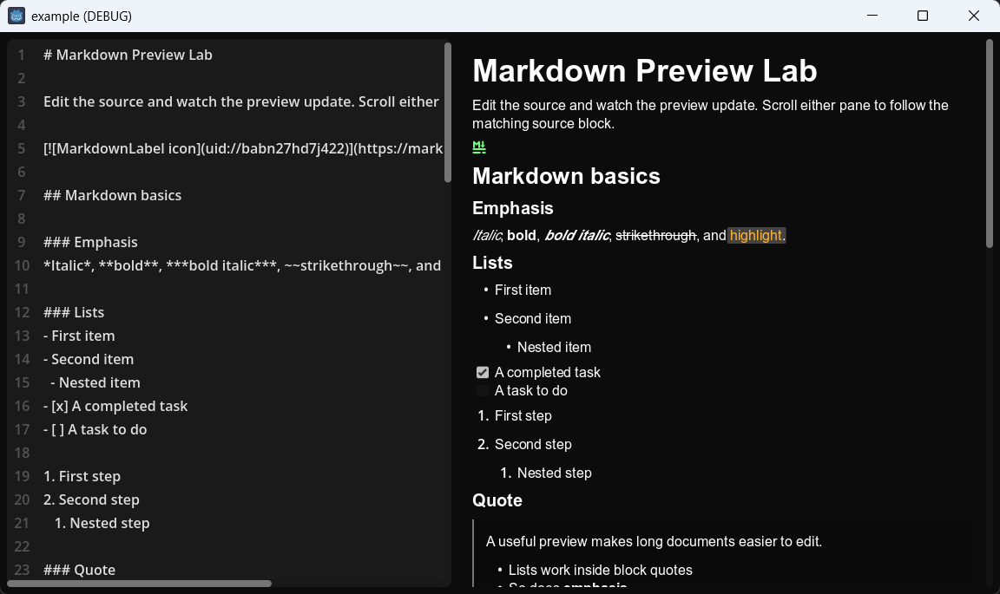
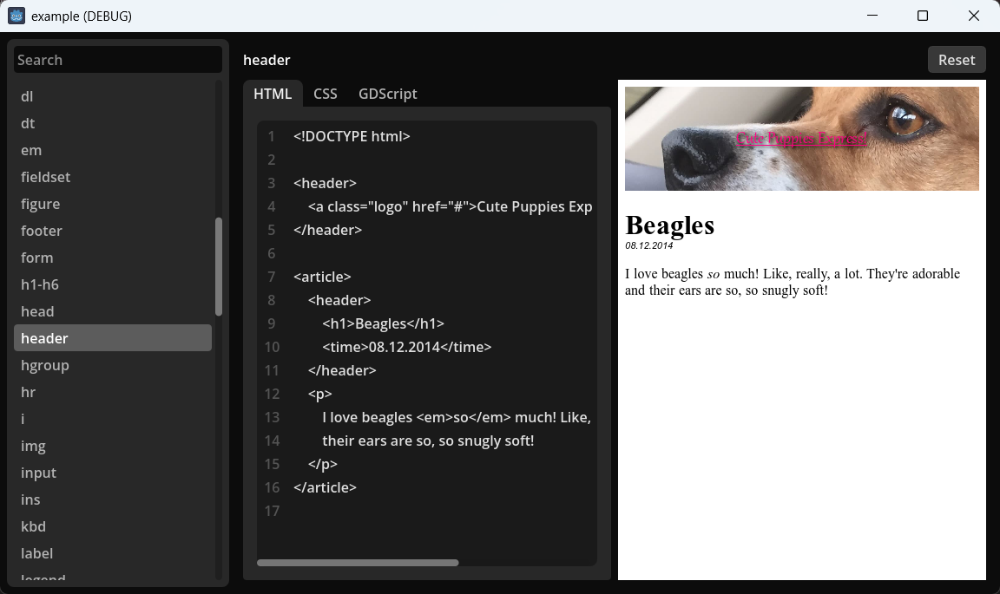
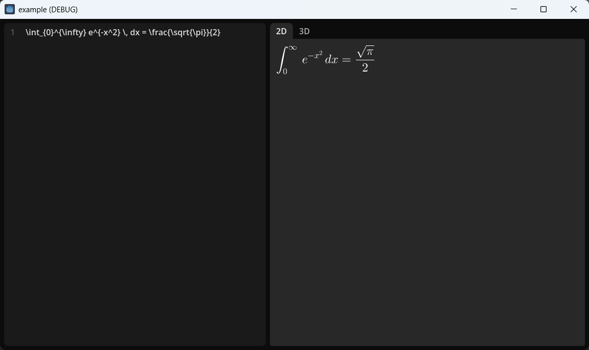
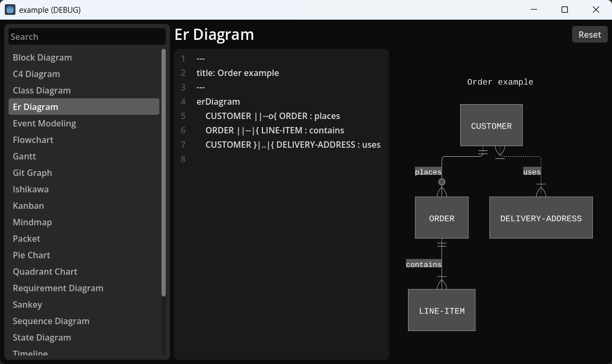
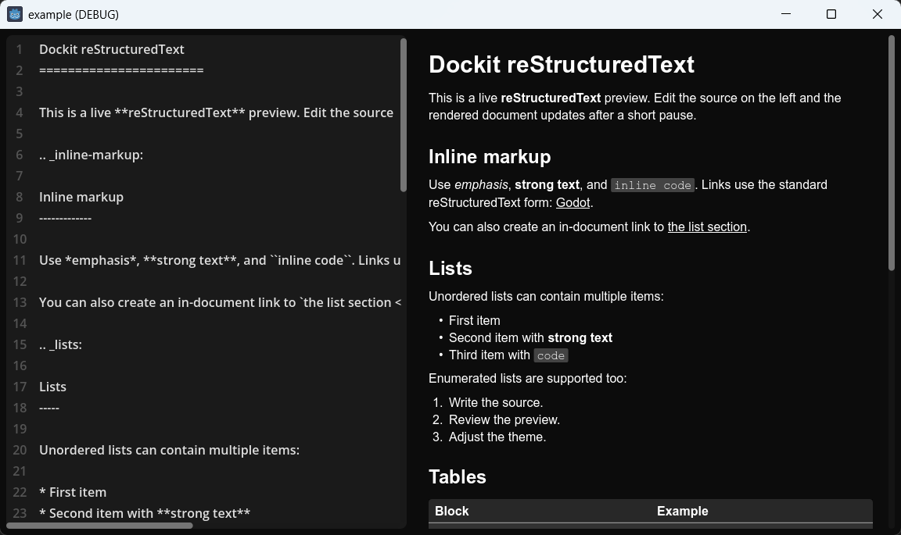
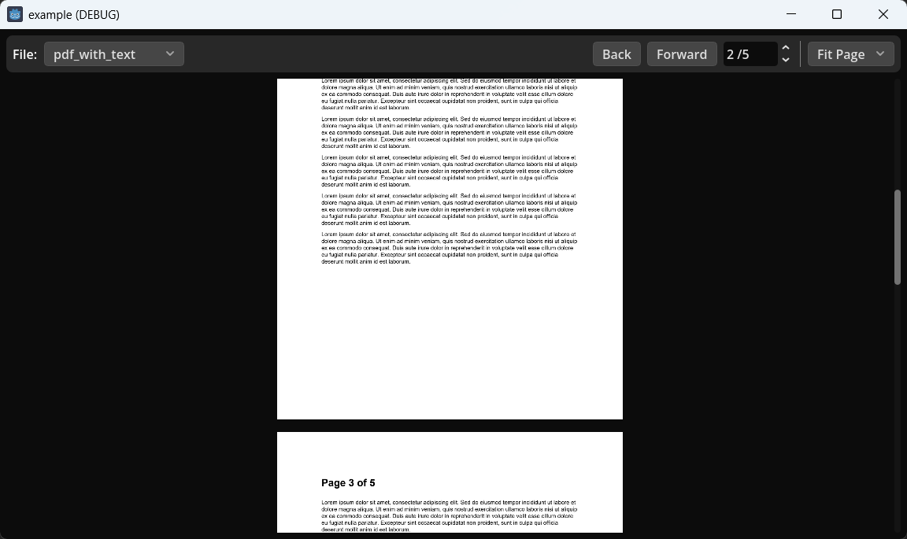

Render interactive Markdown, LaTeX formulas, Mermaid diagrams, PDF pages, HTML, and reStructuredText in Godot 4.

## Features

###  Interactive Markdown

Add a `MarkdownLabel` to a scene and set its `text` property. It supports selection, search, links, and streaming text. 

Enable `parse_html` to render HTML blocks and supported inline tags in Markdown.

###  reStructuredText documents

Import `.rst` files as `RSTDocument` resources and display them with `RestructuredtextLabel`. The label supports relative images and downloads, `toctree` and `:doc:` links, in-document anchors, and cross-document `:ref:` links. Set `dockit/rst/document_roots` in Project Settings to the folders or `.rst` files that contain your documentation; Dockit generates a compact reference index from the labels and documents those files actually reference. The generated index keeps resource UIDs with `res://` paths as a fallback for exported projects.

Connect the `link_pressed` signal on a `RestructuredtextLabel` node to load another document when a user activates an internal document link. Relative images and downloads resolve from the `.rst` source file and do not need to be added to the index roots.

###  Interactive HTML

Assign an imported `HTMLDocument` to an `HTMLLabel` to render standalone `.html` or `.htm` files with CSS. Query and update DOM elements, listen for HTML events, and attach GDScript behavior scripts for interactive documents.

HTMLLabel can play local videos with [EIRTeam.FFmpeg](https://github.com/EIRTeam/EIRTeam.FFmpeg/releases/tag/autobuild-2026-10-07-13-22) or [godot-vlc](https://github.com/xiSage/godot-vlc/releases/tag/v1.3.0). Install either add-on in your project and use `<video src="clip.mp4" controls>`. Imported HTML documents carry their local video sources into exports. For video paths set at runtime, include the files in the export preset. Without a decoder, the video box is black and its controls are disabled.

###    LaTeX formulas and Mermaid diagrams

Display them in Markdown or in standalone nodes. Use `LatexLabel` in UI, `LatexLabel3D` in 3D scenes, and `MermaidLabel` for diagrams on Windows x64 with the Merman backend. 

###  PDF textures and scripting

On Windows x64, import a PDF page as a `PDFTexture` or read and edit PDFs from GDScript. Add `dockit_pdf_reader` to a Windows x64 export preset to include PDFium for runtime reading and writing.

## Examples

All of these examples are included in the plugin:

|||
|:---:|:---:|
|||
|[Markdown Example](addons/dockit/examples/markdown_example)|[HTML Example](addons/dockit/examples/html_example)|
|||
|[LaTeX Example](addons/dockit/examples/latex_example)|[Mermaid Example](addons/dockit/examples/mermaid_example)|
|||
|[reStructuredText Example](addons/dockit/examples/restructuredtext_example)|[PDF Example](addons/dockit/examples/pdf_example)|

## Install

Download the latest release from [GitHub Releases](https://github.com/LuYingYiLong/godot-dockit/releases) and extract the archive into your Godot project root. It contains the `addons/dockit` plugin. To build from source, see [Contributing](CONTRIBUTING.md).

## License

Godot Dockit is licensed under the [MIT License](LICENSE.txt). Third-party components retain their upstream licenses:

- litehtml: BSD 3-Clause; Gumbo and Material Icons: Apache 2.0
- PDFium binary distribution: MIT; PDFium retains its upstream license and bundled dependencies retain theirs
- Merman: MIT and Apache 2.0; bundled components retain their upstream licenses
- Open Sans: SIL Open Font License; MicroTeX, TinyXML-2, Unicode data, and hyphenation data retain their upstream licenses
